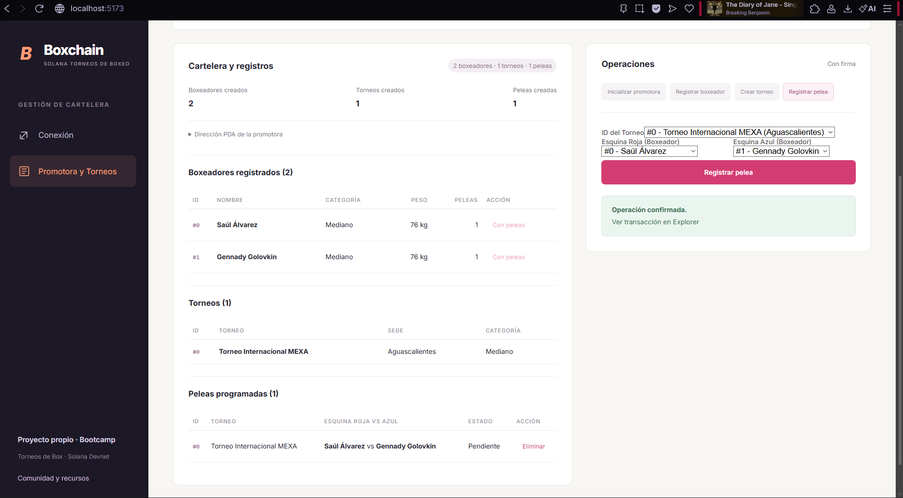

# Boxchain

Aplicación descentralizada (dApp) desplegada en Solana Devnet para la gestión de torneos y carteleras de boxeo. El proyecto integra un programa desarrollado con Anchor (Rust) y una interfaz web construida con React, TypeScript, Vite y las librerías de Solana (`@solana/kit` y `@solana/web3.js`).

El sistema permite a una promotora administrar sus registros directamente en la blockchain mediante cuentas derivadas por programa (PDAs): inicialización de promotora, alta y baja de boxeadores por categoría de peso, creación de torneos y programación de peleas.

## Datos de despliegue en Devnet

- **Red:** Solana Devnet
- **Program ID:** `Hp1EuNXPu3fGuZa94uTri6TJLD9KdHbH69MXAQDdxvw1`
- **Wallet propietaria:** `4RYXUDnS8toHJbk4NFKxWqQvuKMHBz1pYNR14LUTf47T`
- **Transacción verificada (registro de pelea):** [Ver en Solana Explorer](https://explorer.solana.com/tx/4fzxFtmKqsE1TPPdzz7WAFWgjs3cfYdez8Bydy7uBN5E81QyMKVBydLAaF7JDKCfHmC3zz5mZj1UAWeq9N42ptnd?cluster=devnet)

## Evidencia de funcionamiento



Flujo probado en Devnet: inicialización de promotora, registro de dos boxeadores (`Saúl Álvarez` y `Gennady Golovkin`), creación del torneo (`Torneo Internacional MEXA` en Aguascalientes) y programación de la pelea correspondiente.

## Estructura del contrato inteligente

El programa (`torneos_box`) organiza los datos en cuatro cuentas PDA:

- **Promotora** (`["promotora", propietario]`): guarda la autoridad de la cuenta y los contadores de boxeadores, torneos y peleas.
- **Boxeador** (`["boxeador", promotora, id_boxeador]`): almacena nombre, peso, categoría y cantidad de peleas asignadas.
- **Torneo** (`["torneo", promotora, id_torneo]`): registra el nombre del evento, la sede y la categoría.
- **Pelea** (`["pelea", promotora, id_pelea]`): relaciona un torneo con dos boxeadores distintos de la misma categoría.

### Instrucciones implementadas

- `inicializar_promotora`
- `registrar_boxeador`
- `eliminar_boxeador`
- `crear_torneo`
- `registrar_pelea`
- `eliminar_pelea`

## Ejecución local

Requisitos: Node.js 18 o superior y una wallet de Solana (como Phantom o Solflare) configurada en Devnet.

```bash
git clone <URL_DE_TU_REPOSITORIO>
cd BoxChain
npm install
npm run dev
```

## Autor

- Nombre: Damián Miguel Llamas Ramírez
- Correo: utm25090238@utma.edu.mx
- Institución: Universidad Tecnológica Metropolitana de Aguascalientes (UTMA)
